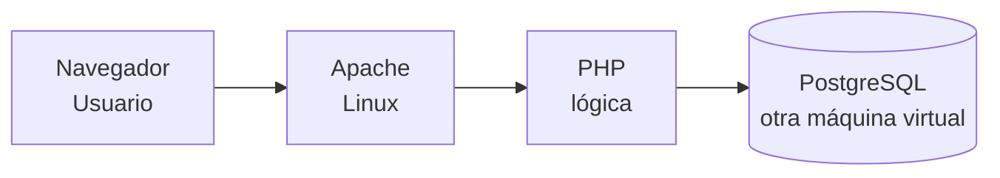

Projecte Intermodular - Valensala

Autor/s: Raul, Alexis y Rafa

Data: 07/10/2026*

Grup: 3

1. Introducció
Explicar el cas d'ús

ValenSala es una web donde se pueden ver en un solo sitio todos los conciertos de las salas de Valencia.

- Qui és el **End User**?

Cualquier persona a la que le guste salir a ver música en directo en Valencia. Las salas también la pueden usar para dar a conocer sus conciertos.

- Quin problema soluciona?

Ahora mismo cada sala pone su programación en su propia web o en sus redes, así que para saber qué hay un día concreto hay que mirar muchas páginas.

- Com soluciona el problema?

Juntando todos los conciertos en una sola web. Ahí se puede buscar por fecha, sala o género, ver la información de cada concierto y de cada sala, y apuntarse con una cuenta.

2. Requeriments
Requeriments funcionals
RF01: Gestion de usuaris
RF02: Gestion de fechas
RF03: Gestion de salas
RF04: Reportes e informes
RF05: Gestion de conciertos y artistas
RF06: Gestion de entradas y compras
Requeriments no funcionals
RNF01: Que la web se vea igual de bien en el móvil y en el ordenador.
RNF02: Que siga el diseño que hicimos en el Style Tile (colores púrpura y crema).
RNF03: Que sea segura: datos validados y consultas a la base de datos preparadas.
User Stories (format: Com a [rol], vull [acció], per a [benefici])
Estimació de punts de les User Stories (Planning Poker / Fibonacci)

!!! TIP Pots organitzar les User Stories en una taula:

| ID   | Com a...      | Vull...                              | Per a...                          | Punts |
|------|---------------|--------------------------------------|-----------------------------------|-------|
| US01 | Desarrollador | tener una plantilla del programa     | tener la base del proyecto        | 6     |
| US02 | Desarrollador | tener una vista del proyecto         | tener las páginas organizadas     | 4     |
| US03 | Desarrollador | tener una plantilla de base de datos | poder crear la base de datos      | 8     |
| US04 | Usuario       | registrarme                          | tener mi cuenta                   | 3     |
| US05 | Usuario       | ver las salas de Valencia            | saber dónde hay música en directo | 2     |
| US06 | Usuario       | ver los conciertos con filtros       | encontrar el que me interesa      | 5     |
3. Estructura Git
Diagrama de l'estructura de branques (Gitflow, Trunk-based, etc.) amb mermaid

En el repositorio tenemos cuatro ramas:

main: la rama principal, con lo que ya está acabado.
dev: la rama para ir juntando el trabajo.
feature/backend_BD: para lo de la base de datos.
feature/backend_php: para el código PHP.
Justificació de l'estructura triada

Cada uno trabaja en su propia rama y a main solo pasamos lo que está terminado. Así podemos trabajar a la vez sin pisarnos el código.

Convenció de noms de branques i commits

Las ramas se llaman feature/ y el nombre de lo que estamos haciendo. Los commits llevan un mensaje corto que explica qué hemos cambiado.

!!! TIP BONUS POINTS BONUS: - Implementar git hooks (pre-commit, commit-msg) per a normalitzar missatges de commit. - Implementar .gitignore adequat al stack. - Ús de Conventional Commits.

4. Tecnologies
Stack triat (Frontend, Backend, Base de Dades, Infraestructura)

Sistema: Linux Infraestructura: Apache Backend: PHP Base de dades: Postgres Frontend: HTML Frontend: CSS

Justificació de la tria de cada tecnologia

Hem escollit para el sistema Linux perque es el que tenim a classe. Hem escollit apache perque es el que anem a gastar en classe. Hem escollit php perque vuiguem practcar php. Hem escollit postgres perque sabem utilitzar-ho. Hem escollit Html i css perque es el estandar hui en dia

- Diagrama d'arquitectura (mermaid)

El usuario abre la web en su navegador, Apache la sirve y PHP se encarga de la lógica. Cuando hace falta guardar o pedir datos, PHP habla con la base de datos PostgreSQL, que está en otra máquina virtual.

5. Solució
Quines pantalles s'han implementat (captures de pantalla)
Crear cuenta (signin.php): un formulario con nombre, correo y teléfono.
Salas (salas.php): la lista de salas con su dirección y su aforo.
Taules de la base de dades implementades
usuario: nombre, email, teléfono y fecha de registro.
sala: nombre, dirección, ciudad y capacidad.
Lògiques de negoci principals implementades
Al registrarse se comprueba que los datos estén bien (nombre y teléfono rellenados y email válido). Si el email ya existe, se avisa.
Después de registrarse, la persona pasa a la página de salas y ve su nombre.
La clase Sala permite guardar, buscar, listar y borrar salas.
Al empezar se crean dos salas de ejemplo: Sala Repvblica (900 personas) y Sala Moon (500).
Funcionalitats pendents / fora d'abast (si n'hi ha)
Iniciar sesión con contraseña y roles.
Conciertos, artistas, entradas y compras.
Buscador, filtros, calendario y mapa.
Reportes e informes.
6. Diagrames
Diagrama de Dades (ER)

Está en los archivos DIAGRAMA_E_R_VALENSALA.drawio y DIAGRAMA_E_R_VALENSALA.png. Tiene estas entidades: Artista, Concierto, Sala, Zona_sala, Entrada, Compra y Usuario.

Diagrama de Classes (si aplica)

Está en los archivos uml.drawio y uml.drawio.png. Tiene las clases Usuario, Sala, Evento y Entrada.

Diagrama de Seqüència d'almenys 1 procés

Así funciona el registro de un usuario:

La persona rellena el formulario y lo envía.
signin.php se conecta a la base de datos y crea el usuario.
Se comprueba que los datos son correctos y se guardan en la tabla usuario.
Si el email ya estaba registrado, se muestra un error.
Si todo va bien, se guarda su nombre y se le lleva a la página de salas.
9. Conclusions
Dificultats trobades
Pensar bien las relaciones del diagrama E/R.
Conectar PHP con una base de datos que está en otra máquina virtual.
Aprenentatges
Trabajar con Git y con ramas.
Organizarnos con SCRUM y Taiga.
Hacer diagramas con draw.io.
Programar en PHP con clases y PDO.
Possibles millores futures
Poder iniciar sesión con contraseña.
Añadir conciertos, entradas y compras.
Añadir buscador, calendario y mapa.
Annexes
Annexe I: SCRUM

En aquest annexe s'inclourà tota la documentació relativa a la gestió del projecte, així com una imatge del Burndown chart

Equipo: Alexis (Scrum Master y desarrollador), Rafael (desarrollador) y Raul (desarrollador).

Repositorio: https://github.com/AlexxisT10/ValenSala-Proyecto.git

Tablero de Taiga: https://tree.taiga.io/project/alexxist10-valensala-proyecto/timeline
